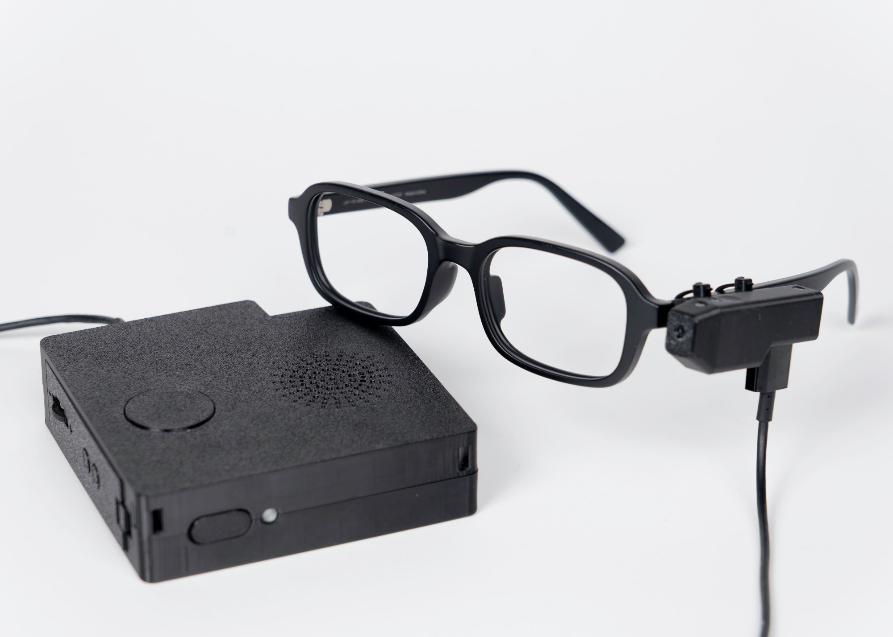

[日本語](README.md) | English

# PHOTON GLASS

This is the hardware data for **PHOTON GLASS**, a glasses-type device that interacts with the user through feedback such as sound, based on images captured by a first-person camera.
PHOTON GLASS was newly developed as a toolkit based on OTON GLASS ver5, glasses that read text aloud, with improved ease of self-building and modifiability.
This repository publishes the design data for the two boards (the main board and the camera board), 3D-printable enclosures for the main body and the camera unit, a cover for the power cable, the program for the main body, and the instructions for assembly and setup.
The program published here is one sample implementation of PHOTON GLASS. It reads aloud text captured by the first-person camera (it recognises the text in the image and speaks it).




## Contents

| Folder | Contents | Software to open it |
|---|---|---|
| [`hardware/`](hardware/README.en.md) | Overview of the two boards, how to open the files, changes from the original design | — |
| [`hardware/main-board/`](hardware/main-board) | Main board (audio and button board that mounts on the Raspberry Pi Zero 2 W) | KiCad 9 or later / Fusion (Eagle format) |
| [`hardware/camera-board/`](hardware/camera-board) | Camera board (connects to the main board with an HDMI cable) | KiCad 9 or later / Fusion (Eagle format) |
| [`enclosure/main-body/`](enclosure/main-body/README.en.md) | Main body enclosure (body front, back and side, main button, sub button, status lamp lens) | F3D (Fusion) / STEP (FreeCAD, etc.) / STL, 3MF (slicer) |
| [`enclosure/camera-unit/`](enclosure/camera-unit/README.en.md) | Camera unit enclosure and attachment for glasses | STEP (Fusion, FreeCAD, etc.) / STL, 3MF (slicer) / Python (CadQuery) |
| [`enclosure/usb-power-cable/`](enclosure/usb-power-cable/README.en.md) | How to make the cable that powers the main board from a mobile battery (wiring and parts), and a cover for the USB plug | STEP / STL / Python (CadQuery) |
| [`software/`](software/README.en.md) | Main programs and sound effects. Use `main_async.py` day to day; to learn how it works, read `main_seq.py`, whose flow is easier to follow (for the differences, see [`software/README.en.md`](software/README.en.md)) | Python 3 (Raspberry Pi) |
| [`software/test/`](software/test) | Script for testing the hardware after assembly (run on the Raspberry Pi) | Python 3 |
| [`docs/`](docs) | Build guide ([`BUILD_GUIDE.en.md`](docs/BUILD_GUIDE.en.md)), Raspberry Pi setup ([`SETUP_RASPBERRY_PI.en.md`](docs/SETUP_RASPBERRY_PI.en.md)), parts list ([`parts_list.en.md`](docs/parts_list.en.md): datasheets and results of checking the schematic symbols) | — |

## Getting started
- **Read first**: [`docs/BUILD_GUIDE.en.md`](docs/BUILD_GUIDE.en.md) sets out the order of the work, from ordering to getting it running, and the document to read for each step.
- **Make the boards**: Following [`hardware/JLCPCB_ORDERING.en.md`](hardware/JLCPCB_ORDERING.en.md), you can order the boards from JLCPCB, including parts assembly (Gerbers, a bill of materials and a component placement file are provided).
- **Print the enclosures**: Print settings (Bambu Lab A1 / PETG) and assembly instructions are in [`enclosure/main-body/README.en.md`](enclosure/main-body/README.en.md) for the main body and in [`enclosure/camera-unit/README.en.md`](enclosure/camera-unit/README.en.md) for the camera unit.
- **Prepare the Raspberry Pi**: [`docs/SETUP_RASPBERRY_PI.en.md`](docs/SETUP_RASPBERRY_PI.en.md) describes the steps from writing the OS to the hardware test and automatic start-up.
- **Change the design**: Edit the boards in KiCad or Fusion, and the enclosures by importing the STEP files into your CAD software (the main body also has the Fusion source data, `.f3d`; the camera unit and the power cable cover can also be regenerated by changing the values in the Python scripts in `src/`).

## Questions and bug reports

Questions and bug reports are accepted through GitHub Issues.
https://github.com/photonglass/photonglass/issues

## Charter
The principles and use of PHOTON GLASS, its name, and patents are set out in the [Charter (`CHARTER.en.md`)](CHARTER.en.md).

## Licences
Copyright (C) OTON GLASS Inc.

Each category is released under the following licence.

| Category | What it includes | Licence | Full text |
|---|---|---|---|
| Software | The programs in `software/` (`main_async.py`, `main_seq.py`, `test/`, etc.) | GNU General Public License v3.0 (GPL-3.0-only) | [`LICENSE`](LICENSE) |
| Hardware | `hardware/` (board data in KiCad and Eagle formats, BOM and CPL, and the script that makes the Gerbers, `hardware/tools/gerbgen.py`), `enclosure/` (CadQuery scripts and design data for the enclosures, including the Fusion source data `.f3d` of the main body), and their outputs (Gerbers, STL, STEP and 3MF). **Exception**: READMEs, photos and images, and `hardware/JLCPCB_ORDERING.md` are excluded (they are CC BY-SA 4.0 as documentation, photos and images) | CERN Open Hardware Licence Version 2 - Strongly Reciprocal (CERN-OHL-S v2) | [`LICENSE-HARDWARE`](LICENSE-HARDWARE) |
| Documentation, photos and images | `docs/`, `CHARTER.md`, `CONTRIBUTING.md`, the `README.md` in each folder, `hardware/JLCPCB_ORDERING.md`, the issue templates (`.github/ISSUE_TEMPLATE/`), photos and images (`images/` in each folder, etc.) | Creative Commons Attribution-ShareAlike 4.0 International (CC BY-SA 4.0) | Official text: [Japanese](https://creativecommons.org/licenses/by-sa/4.0/legalcode.ja), [English](https://creativecommons.org/licenses/by-sa/4.0/legalcode.en) |
| Sounds | The sound effects in `software/sound/` | CC BY-SA 4.0 | As above |

- The READMEs, photos and images, and `hardware/JLCPCB_ORDERING.md` are CC BY-SA 4.0 even when they are inside `hardware/`, `enclosure/` or `software/`. `software/sound/` is also CC BY-SA 4.0, although it is inside `software/`.
- The English versions of the documents (files whose names end in `.en.md`, such as `README.en.md`, `CHARTER.en.md` and `hardware/JLCPCB_ORDERING.en.md`) are also CC BY-SA 4.0, the same as the Japanese versions.

### Credit notation for CC BY-SA 4.0
The documentation, photos, images and sounds are provided by OTON GLASS Inc. under CC BY-SA 4.0. The full text is not included in this repository, so please refer to the official text ([Japanese](https://creativecommons.org/licenses/by-sa/4.0/legalcode.ja), [English](https://creativecommons.org/licenses/by-sa/4.0/legalcode.en)).

When you use them, please give credit as follows. If you have modified them, please also state that you did so.
```
PHOTON GLASS（Copyright (C) 株式会社オトングラス）
https://github.com/photonglass/photonglass
CC BY-SA 4.0 https://creativecommons.org/licenses/by-sa/4.0/
```
(株式会社オトングラス is the Japanese name of OTON GLASS Inc.)

### Plain-language summary
For the exact terms, see the full text of each licence.

**What you can do**
- Anyone can use this data, free of charge, to make, use and sell boards and enclosures.
- You can modify it freely.

**What you must do**
- When you distribute or sell what you have made or modified, release it under the same licence as the original.
  - For software and hardware, make sure that the people who receive it can obtain the source (the program or the design data). For hardware, either provide the source or tell them where it is available.
- Do not remove the copyright and licence notices. If you modify something, state when and what you changed.
- When you use the documentation, photos, images or sounds, give the credit shown above.

**Other points**
- There is no warranty (the authors accept no responsibility if what you make does not work).
- If you only use it yourself, you are not obliged to publish your modified data.
- For how the patent is handled, see ["3. Patents"](CHARTER.en.md#3-patents) in the Charter.

### Commercial licence
If you wish to use it in a way that differs from the terms of these licences, such as building it into a closed product, a commercial licence can be agreed individually. Contact: https://note.com/keisukeshimakage/n/nef3c9957ae25

### Not included
- 3D models of components distributed by component manufacturers or by EasyEDA/LCSC (because their redistribution terms are unclear). Check the 3D shape of the boards in the 3D view of KiCad or Fusion.
- A Google Cloud API key (get your own and write it in `api_key.txt`, in the same folder as the program; for how, see [`software/README.en.md`](software/README.en.md#how-to-run)).

### Credits
**PHOTON GLASS (2026)**
- Circuit and board design, documentation: Masaharu Yamanaka (山中将治)
- Product design: Yasutomo Komatsu (小松靖知)
- Programming: Hinata Ishizuka (石塚日向)
- Advising: Hiroya Suda (須田拓也), Takuma Takahashi (高橋卓久真), Chen Kuan-Yu (陳冠宇)

**OTON GLASS ver5 (2019) — the model on which PHOTON GLASS is based**
- Engineering: Keita Miyashita (宮下恵太)
- Server-side engineering: Hideki Tsuruoka (鶴岡秀樹)
- Product design: Tomomasa Sano (佐野友優)
- Sound design: Kenta Tanaka (田中堅大)
