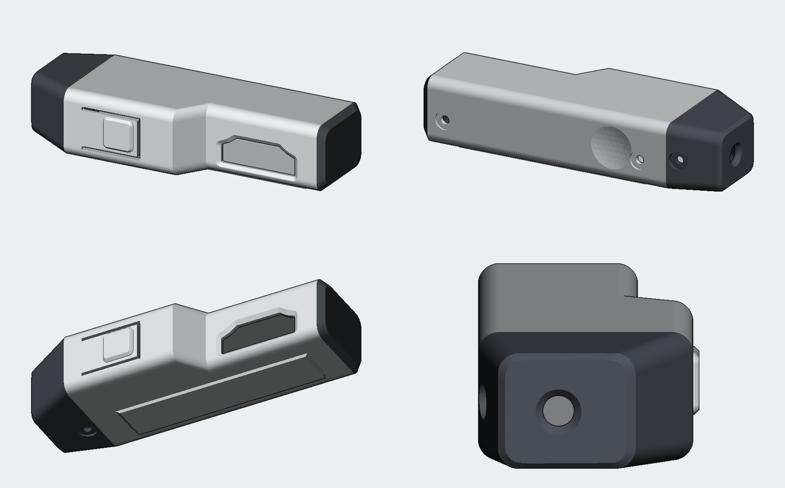

# PHOTON GLASS – open hardware

一人称のカメラで捉えるイメージから，音などのフィードバックでユーザーにインタラクションする，メガネ型のデバイス〈PHOTON GLASS〉のハードウェアデータです。
PHOTON GLASS は、OTON GLASS ver5 を元にしながら、自作の容易さや改変性を高め、ツールキットとして新しく開発したものです。
基板2枚（メイン基板・カメラ基板）と、3Dプリンターで造形できるカメラユニットの筐体を公開しています。

*English summary below.*

## 中身

| フォルダ | 内容 | 開けるソフト |
|---|---|---|
| [`hardware/main-board/`](hardware/main-board) | メイン基板（Raspberry Pi Zero 2 W に載る音声・ボタン基板） | KiCad 9 / Fusion（Eagle形式） |
| [`hardware/camera-board/`](hardware/camera-board) | カメラ基板（HDMIケーブルでメイン基板とつながる） | KiCad 9 / Fusion（Eagle形式） |
| [`enclosure/camera-unit/`](enclosure/camera-unit) | カメラユニットの筐体・メガネ用アタッチメント | STEP（Fusion・FreeCAD など）/ STL・3MF（スライサー）/ Python（CadQuery） |
| [`enclosure/usb-power-cable/`](enclosure/usb-power-cable) | モバイルバッテリーからメイン基板へ給電するケーブルの作り方（配線・部品）と、USB プラグのカバー | STEP / STL / Python（CadQuery） |
| [`software/`](software) | 本体プログラムと効果音。普段使うのは `main_async.py`、仕組みを学ぶなら流れの読みやすい `main_seq.py`（違いは [`software/README.md`](software/README.md)） | Python 3（Raspberry Pi） |
| [`software/test/`](software/test) | 組み立て後の動作テスト用スクリプト（Raspberry Pi で実行） | Python 3 |
| [`docs/`](docs) | 部品リスト（データシート・回路記号の照合結果） | ブラウザ |

## はじめての人へ
- **基板を作る**：[`hardware/JLCPCB_ORDERING.md`](hardware/JLCPCB_ORDERING.md) の手順で、JLCPCB に部品実装まで発注できます（ガーバー・部品表・部品配置ファイル付き）。
- **筐体を印刷する**：[`enclosure/camera-unit/README.md`](enclosure/camera-unit/README.md) に、印刷設定（Bambu Lab A1 / PETG）と組み立て手順があります。
- **設計を変える**：基板は KiCad か Fusion で、筐体は `src/` の Python スクリプトの数値を変えるか、STEP を CAD に読み込んで編集します。

## ライセンス
このリポジトリのすべて（基板・筐体の設計データ、プログラム、説明文・画像）は **GNU General Public License v3.0（GPL-3.0-only）** で公開しています。全文は [`LICENSE`](LICENSE) にあります。

Copyright (C) 2019-2026 OTON GLASS open hardware contributors

**できること**
- 誰でも無料で、このデータで基板や筐体を作り、使い、売ることができます。
- 自由に改造できます。

**守ること**
- 作ったもの・改造したものを人に配ったり売ったりするときは、その**設計データ（ソース）も GPLv3 で公開**し、受け取った人が手に入れられるようにする。
- 著作権表示とこのライセンスを消さない。改造した場合は、どこを変えたかを書く。

**その他**
- 無保証です（作ったものが動かなくても、作者は責任を負いません）。
- 自分で使うだけなら、改造したデータを公開する義務はありません。

**含まれていないもの**
- 部品メーカーや EasyEDA/LCSC が配布している部品の3Dモデル（再配布の条件がはっきりしないため）。基板の3D形状は KiCad や Fusion の3Dビューで確認してください。
- Google Cloud の API キー（各自で用意して、プログラムの `api_key` に書く）。

## クレジット
- 原設計：OTON GLASS ver5（2019年発表。基板・筐体の型番は OG19）
- PHOTON GLASS（2026年）：JLCPCB部品への置き換え、基板の修正、3Dプリンター向けの筐体の新規設計

---

## English summary
Hardware for **PHOTON GLASS**, a glasses-type device that interacts with users via feedback such as sound, based on images captured by a first-person camera.
PHOTON GLASS was newly developed as a toolkit based on OTON GLASS ver5, with improved ease of self-building and modifiability.
- `hardware/` – main board and camera board (KiCad 9 and Eagle/Fusion formats, Gerbers, JLCPCB BOM/CPL)
- `enclosure/camera-unit/` – FDM-printable camera enclosure: STEP, print-ready STL/3MF, parametric CadQuery source, print settings
- Licence: everything in this repository is **GPL-3.0-only** (see `LICENSE`)
