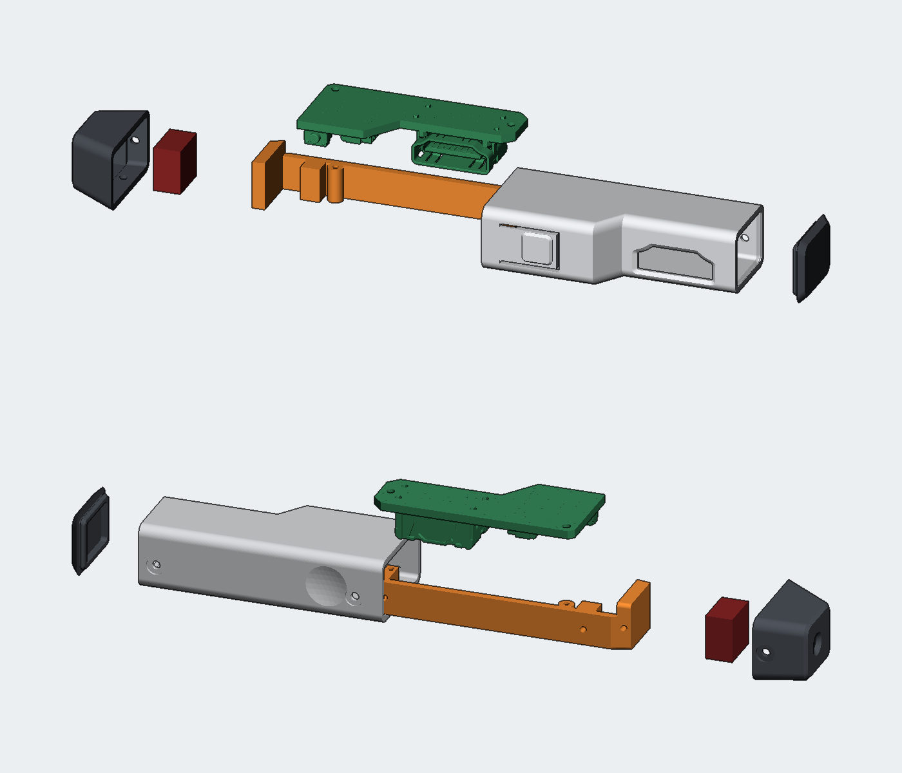
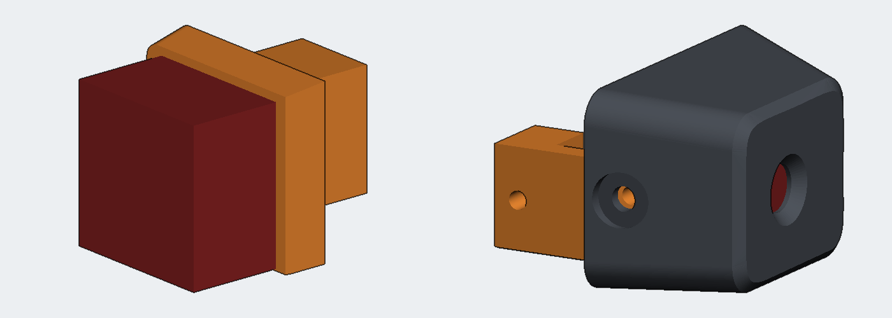
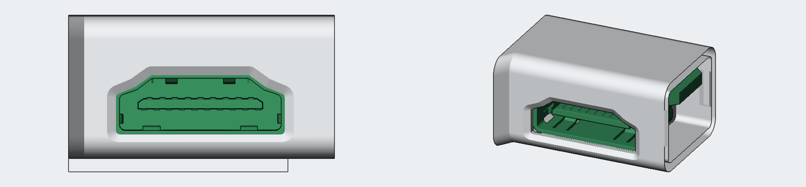
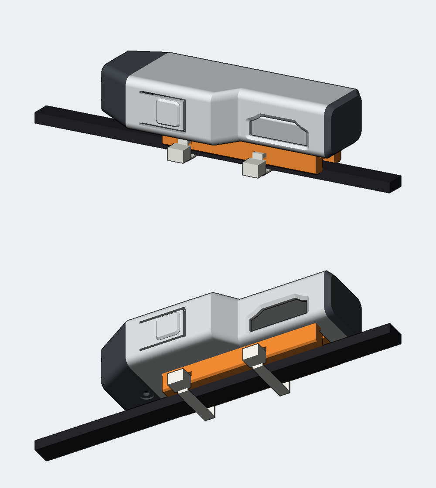

[日本語](README.md) | English

# Camera unit enclosure

An enclosure designed to be printed on an FDM 3D printer (0.4 mm nozzle). Support is needed only under the tongue of the catch on the attachment; all the other parts can be printed without support.



## Files
| Folder | Format | Use |
|---|---|---|
| `src/` | Python (CadQuery) | **Source design data**. Change the values and run it to regenerate all the parts |
| `step/` | STEP | For CAD. Can be opened and edited in Fusion, FreeCAD, SolidWorks, Onshape, etc. (parts are in their assembled positions) |
| `stl/` | STL | For printing. **Already oriented for printing**, so load them into the slicer as they are |
| `3mf/` | 3MF | For printing. All the parts arranged on one A1 plate |

### Parts
| Part | File name | Print orientation |
|---|---|---|
| Body (tube and shutter in one piece) | `body` | Standing upright, lens end down |
| Camera lid | `nose` | Lens face down |
| Rear cap | `tail` (`tail_loose` if it is too tight) | Outer face down |
| Sled (carrier for the board and camera) | `sled` | Bottom face down |
| Attachment for glasses (cable-tie type) | `temple_tie_clip` | V-groove face down |

## Print settings
These settings are for the Bambu Lab A1 with Bambu Studio. For other printers, apply the same approach.

| Item | Setting | Reason |
|---|---|---|
| Nozzle | 0.4 mm | |
| Material | **PETG** (the order list uses Bambu Lab PETG Basic, black; Bambu PETG HF and others can also be used) | The shutter spring and the catches of the rear cap are less likely to crack. PLA is fine for checking the shape |
| Process preset | 0.16mm Optimal @BBL A1 | |
| Wall loops | **3** | The walls are designed to be 1.2 mm, so three loops make them solid all the way through |
| Top / bottom shell layers | 5 / 4 | |
| Sparse infill | 20 % (gyroid) | |
| Support | **Off** (except for the attachment; see below) | The body, lid, cap and sled are shaped so that they print without support |
| Precise wall | On | Improves the accuracy of the fits |
| Elephant foot compensation | 0.15 mm | If the first layer spreads, the caps will not fit |
| Bridge fan speed | 100 % | Prints the tops of the HDMI opening and the grooves cleanly |
| Part cooling fan | 30–50 % | Standard for PETG |
| Build plate | Textured PEI | On a smooth PEI plate, apply glue stick |

### Extra settings for the body only
- **Brim: outer brim only, 5 mm wide.** The body is 47 mm tall with only a small area touching the bed, and the A1's bed moves back and forth.
- Place the body so that its long side (about 21 mm) runs **front to back** on the bed.
- Reduce the outer wall speed to about 100 mm/s.

### Extra settings for the attachment only
- **Add support only under the tongue of the catch** (the tongue is a cantilever with nothing underneath, so only it needs support; the cable-tie holes have 3 mm bridged ceilings and need no support).
  1. Process → Support: turn on "Enable support", set the type to **"normal(manual)"**, and set "Top Z distance" to 0.2 mm.
  2. Select the attachment, open support painting (`L`) → "Enforce" → the "Fill" tool, and click the rectangular face on the underside of the tongue to paint it.
  - If you keep automatic support instead, use "Block" in the same support painting tool to paint the ceilings of the two cable-tie holes.
- Lower the layer height to **0.12 mm** (the 0.6 mm retaining barb is then printed in five layers, so its shape comes out clearly).
- Set the seam position to "Back", or use seam painting to put the seam on a side face away from the catch (a seam on the catch makes it chip).
- Reduce the speed for small perimeters to about 30 mm/s.

### Adjusting the fit
- The rear cap is tight → use `tail_loose`.
- The caps are tight overall → set "X-Y contour compensation" to −0.05 mm for that object only.

## Required parts
| Part | Where to buy | Qty |
|---|---|---|
| Camera board ([`hardware/camera-board`](../../hardware/camera-board)) | JLCPCB ([`hardware/JLCPCB_ORDERING.en.md`](../../hardware/JLCPCB_ORDERING.en.md)) | 1 |
| Camera: Adafruit 3508 "Zero Spy Camera for Raspberry Pi Zero", standard-lens version (8.6 × 8.6 × 5.2 mm, with double-sided tape on the back). The fisheye version cannot be used (see the note below) | Mouser | 1 |
| Screws: WILCO (ウィルコ) FXB-1430EB (M1.4 × 3.0 low-head B-tite, black): 2 for the lid, 2 for the board, 2 for the back of the body | WILCO | 6 |
| Screws: WILCO (ウィルコ) FBP-0208EB: not used in the camera unit (they are for the main body enclosure; see [`../main-body`](../main-body/README.en.md#required-parts)) | — | — |
| Cable ties (2.5 mm wide × 1.0 mm thick, about 100 mm long) | Generic | 2 |

- **Use the Adafruit 3508 camera (the standard-lens version).** The version with a 120° fisheye lens (Adafruit 5389) is a different product. Its image is distorted, so it cannot be used for reading text aloud. Check the product number 3508 when you buy it.

## Assembly
1. Place the board on the sled with its component side down, and fix it with two screws through the two holes in the board.
2. Connect the camera's flex cable to the connector on the board (CN2).
3. Slide the whole sled into the opening at the lens end of the body, and fix it with two screws through the two holes in the back of the body.
4. Peel the backing paper off the camera's double-sided tape and put the camera, lens forward, into the square hole in the camera lid.
5. Press the lid against the body while guiding the flex cable out of the way towards the shutter side. The back of the camera sticks to the wall at the tip of the sled.
6. Fix the lid with two screws, through its back face and its head-side face.
7. Push the rear cap in until it snaps into place all the way round.
8. Slide the attachment onto the rail from the lens end and push it until it clicks into place.
9. Lay the V-groove of the attachment along the temple (arm) of the glasses and fix it with two cable ties.

The screws cut their own threads in the plastic. Stop tightening as soon as they stop turning.



*Mounting the camera (left: the camera stuck to the wall at the tip of the sled; right: with the lid on)*



*The HDMI opening in the body (the HDMI connector of the camera board can be seen inside)*



*Attached to the temple of a pair of glasses (the attachment is orange, the cable ties are white)*

## Changing the design
```bash
pip install cadquery
python src/camera_case.py out/          # 本体・蓋・キャップ・スレッド
python src/temple_tie_clip.py out/      # アタッチメント（結束バンドの幅・厚さを指定可：... out/ 2.5 1.0）
```
(The comments mean: `camera_case.py` makes the body, lid, cap and sled; `temple_tie_clip.py` makes the attachment, and you can specify the width and thickness of the cable ties, as in `... out/ 2.5 1.0`.)

The dimensions can be changed with the constants at the top of each script (wall thickness, clearances, etc.). Coordinates are in mm, with the camera board placed component side down as the reference.
- The STLs that `camera_case.py` outputs are in their assembled positions (the same orientation as `step/`). For printing, reorient them in the slicer as shown in the "Print orientation" column of the "[Parts](#parts)" table above (the files in `stl/` have been reoriented in this way).
- The attachment is output as `tie_clip.step` and `tie_clip.stl` (these correspond to `temple_tie_clip.*` in `step/` and `stl/`). Its STL is already in the print orientation.
