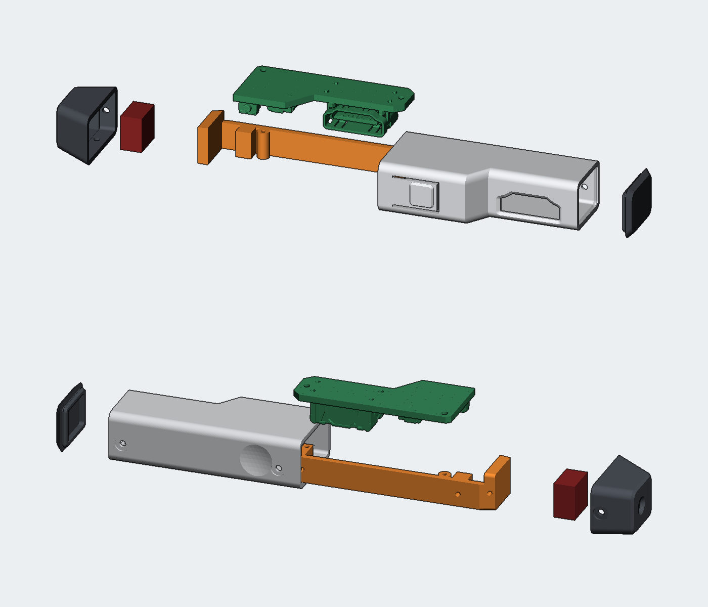

# カメラユニットの筐体 / Camera unit enclosure

FDM方式の3Dプリンター（0.4 mm ノズル）で、サポートなしで印刷できるように設計した筐体です。



## ファイル
| フォルダ | 形式 | 用途 |
|---|---|---|
| `src/` | Python（CadQuery） | **設計の元データ**。数値を変えて実行すると全部品を作り直せる |
| `step/` | STEP | CAD 用。Fusion・FreeCAD・SolidWorks・Onshape などで開いて編集できる（組み立てた位置のまま） |
| `stl/` | STL | 印刷用。**印刷する向きにそろえてある**ので、そのままスライサーに入れる |
| `3mf/` | 3MF | 印刷用。全部品を A1 のプレート1枚に並べたもの |

### 部品
| 部品 | ファイル名 | 印刷の向き |
|---|---|---|
| 本体（筒・シャッター一体） | `body` | レンズ側の端を下にして立てる |
| カメラの蓋 | `nose` | レンズの面を下 |
| 後ろキャップ | `tail`（固すぎるときは `tail_loose`） | 外側の面を下 |
| スレッド（基板とカメラを載せる台） | `sled` | 底面を下 |
| メガネ用アタッチメント（結束バンド式） | `temple_tie_clip` | V字の溝の面を下 |

## 印刷設定
Bambu Lab A1・Bambu Studio での設定です。ほかのプリンターでも、同じ考え方で設定してください。

| 項目 | 設定 | 理由 |
|---|---|---|
| ノズル | 0.4 mm | |
| 材料 | **PETG**（Bambu PETG HF など） | シャッターのばねと後ろキャップの爪が割れにくい。PLA でも形は確認できる |
| プロセスのプリセット | 0.16mm Optimal @BBL A1 | |
| 壁のループ数 | **3** | 壁は 1.2 mm で設計しているので、3周で中まで詰まる |
| 上面 / 底面シェル層 | 5 / 4 | |
| インフィル | 20 %（ジャイロイド） | |
| サポート | **オフ**（アタッチメントだけ例外、下記） | 本体・蓋・キャップ・スレッドはサポートなしで刷れる形にしてある |
| 精密な壁 | オン | はめ合いの精度が上がる |
| エレファントフット補正 | 0.15 mm | 1層目が広がるとキャップがはまらなくなる |
| ブリッジのファン速度 | 100 % | HDMI の口や溝の天井をきれいに刷る |
| パーツ冷却ファン | 30–50 % | PETG の標準 |
| ビルドプレート | テクスチャ PEI | スムースPEIの場合はスティックのりを塗る |

### 本体だけの追加設定
- **ブリム：外側のみ、幅 5 mm**。本体は高さ 47 mm でベッドに接する面が小さく、A1 はベッドが前後に動くため。
- 本体の長い辺（約 21 mm）がベッドの**前後方向**に沿うように置く。
- 外壁の速度を 100 mm/s 程度に下げる。

### アタッチメントだけの追加設定
- **サポートは爪の舌の下だけに入れる**（舌は下側が空いた片持ちなので、そこだけサポートが要る。結束バンドの穴は天井 3 mm のブリッジなのでサポート不要）。
  1. プロセス → サポート：「サポートを有効」をオン、タイプを **「標準（手動）」**、上面Z距離 0.2 mm。
  2. アタッチメントを選んでサポートペイント（`L`）→「強制」→ ツール「塗りつぶし」で、舌の裏の長方形の面をクリックして塗る。
  - 自動サポートのまま使う場合は、同じサポートペイントの「ブロック」で結束バンドの穴2つの天井を塗る。
- 積層ピッチを **0.12 mm** に下げる（抜け止めの爪 0.6 mm が5層になり、形がはっきり出る）。
- 継ぎ目の位置を「背面」にするか、継ぎ目ペイントで爪から離れた側面に置く（爪の上に継ぎ目が来ると欠ける）。
- 小さい外周の速度を 30 mm/s 程度に下げる。

### はまり具合の調整
- 後ろキャップがきつい → `tail_loose` を使う。
- キャップ類が全体にきつい → そのオブジェクトだけ「X-Y輪郭補正」を −0.05 mm にする。

## 必要な部品
| 部品 | 数 |
|---|---|
| カメラ基板（[`hardware/camera-board`](../../hardware/camera-board)） | 1 |
| カメラ Zero Spy Camera for Raspberry Pi Zero（8.6 × 8.6 × 5.2 mm、裏に両面テープ付き） | 1 |
| ネジ ウィルコ FXB-1430EB（M1.4 × 3.0 低頭Bタイト） | 6 |
| 結束バンド（幅 2.5 mm × 厚さ 1.0 mm、長さ 100 mm 程度） | 2 |

## 組み立て
1. 基板の部品面を下にしてスレッドに載せ、基板の穴2つからネジ2本で留める。
2. カメラのフレキケーブルを基板のコネクタ（CN2）につなぐ。
3. スレッドごと、本体のレンズ側の口から差し込み、本体背面の穴2つからネジ2本で留める。
4. カメラの両面テープの剥離紙をはがし、レンズを前にしてカメラの蓋の四角い穴に入れる。
5. フレキケーブルをシャッター側に逃がしながら蓋を本体に押し当てる。カメラの裏がスレッド先端の壁に貼り付く。
6. 蓋の背面と頭側の面から、ネジ2本で留める。
7. 後ろキャップを、一周パチンとはまるまで押し込む。
8. アタッチメントを、レンズ側からレールに差し込み、カチッと止まるまで押す。
9. アタッチメントの V字の溝をメガネのつるに沿わせ、結束バンド2本で固定する。

ネジは樹脂に自分でねじ山を切るタイプです。止まったところで締めるのをやめてください。

## 設計を変える
```
pip install cadquery
python src/camera_case.py out/          # 本体・蓋・キャップ・スレッド
python src/temple_tie_clip.py out/      # アタッチメント（結束バンドの幅・厚さを指定可：... out/ 2.5 1.0）
```
寸法はスクリプトの先頭の定数（壁の厚さ、すき間など）で変えられます。座標はカメラ基板を部品面を下にして置いた位置が基準（mm）です。
