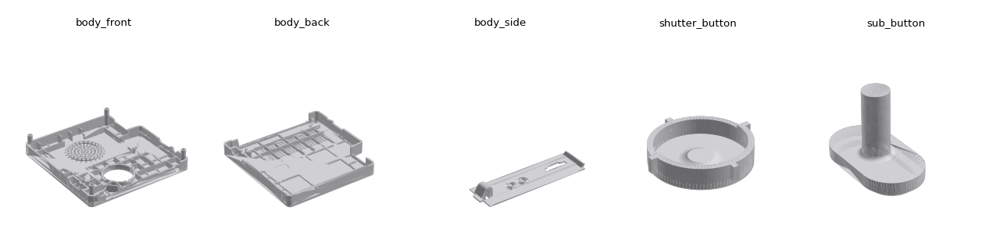
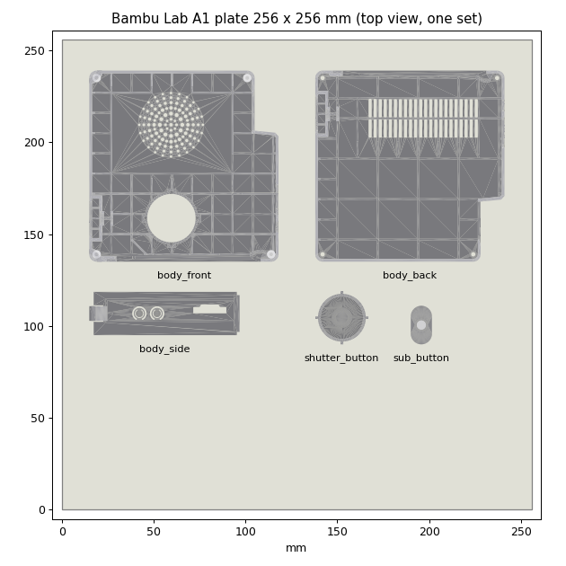

[日本語](README.md) | English

# Main body enclosure

This is the enclosure for the PHOTON GLASS main body (with the main button and the sub button). It is a separate enclosure from the camera unit ([`../camera-unit`](../camera-unit/README.en.md)).
It can be printed on an FDM 3D printer (0.4 mm nozzle). Support is needed only under the flange of the sub button.
Only the status lamp lens is printed separately, in clear PETG (it is the part that carries the light of the RGB LED on the board to the outside of the main body).

## Files
| Folder | Format | Use |
|---|---|---|
| `fusion/` | F3D | **Source design data** (the Fusion archive `main-body.f3d`). Open it in Fusion to edit it together with its design history. It also contains reference mock-ups for checking positions (main board, Raspberry Pi, speaker, mobile battery) |
| `step/` | STEP | Can be opened and edited in CAD software other than Fusion, such as FreeCAD, SolidWorks and Onshape (parts are in their assembled positions). `main-body.step` was exported directly from Fusion and contains the body front, back and side, the status lamp lens, and a reference mock-up of the mobile battery. `shutter_button.step` and `sub_button.step` are the main button and the sub button |
| `stl/` | STL | For printing. **Already oriented for printing**, so load them into the slicer as they are |
| `3mf/` | 3MF | For printing. `main-body_plate_A1.3mf` has the parts for one unit (the five black parts) arranged on one A1 plate. `status_lens_plate_A1.3mf` has eight status lamp lenses (clear, including spares) |

### Parts
One of each is used per unit. Print the status lamp lens in clear PETG, and the others in black (or another colour of) PETG.

| Part | File name | Size (as printed) | Print orientation |
|---|---|---|---|
| Body front | `body_front` | 103 × 104 × 25.9 mm high | Outer face down |
| Body back | `body_back` | 103 × 104 × 14.5 mm high | Outer face down (turned over from the design data) |
| Body side | `body_side` | 81.8 × 23.6 × 12.3 mm high | Lying on its largest face |
| Main button | `shutter_button` | 29 mm diameter × 8 mm high | Closed bottom down |
| Sub button | `sub_button` | 11.5 × 21 × 21.3 mm high | Standing upright: oval flange down, shaft up |
| Status lamp lens | `status_lens` | 6 × 5 × 2.6 mm high | Square plate down, round dome (4 mm diameter) up |

The plates are 1.5 mm thick and the thin walls are 1.0 mm.

The four buttons on the main body (main, sub, up and down; GPIO 27, 22, 23 and 24 respectively) are buttons you are free to use by modifying the program. The sample program uses only the sub button, in `main_async.py` (to stop reading aloud, etc., partway through); the others are not used. Taking photos and reading aloud are done with the button on the camera unit (GPIO17). The up and down buttons are part of the body side.

## Print settings
These settings are for the Bambu Lab A1 with Bambu Studio. For other printers, apply the same approach.

### Presets to choose
| Item | Setting |
|---|---|
| Printer | Bambu Lab A1 (0.4 mm nozzle) |
| Filament | **Bambu PETG HF** (or PETG Basic; for other makers' filament, Generic PETG) |
| Process | **0.20mm Standard @BBL A1** |
| Build plate | **Textured PEI**. On a smooth PEI plate, apply a thin layer of glue stick (this stops the PETG sticking so strongly that it tears the PEI) |

The temperatures (nozzle around 250 °C, bed 70 °C) and the fan can be left as they are in the filament preset.

### Changes from the presets
| Item | Setting | Reason |
|---|---|---|
| Wall loops | **3** | To print the 1.0 mm and 1.5 mm walls solid all the way through |
| Wall generator | **Arachne** | Prints the thin 1.0 mm walls without gaps |
| Top / bottom shell layers | **5 / 4** | To make the 1.5 mm plates solid all the way through |
| Sparse infill | 20 % (gyroid) | Many of the parts are thin, so in practice they end up almost solid |
| Seam position | **Back** (or "Aligned") | To keep seam lines off the outer faces |
| Precise wall | On | Improves the accuracy of the fits |
| Elephant foot compensation | **0.15 mm** | If the first layer spreads, the front, back and buttons become hard to fit together |
| Outer wall speed | 120–150 mm/s | Improves the outer appearance and dimensional accuracy. Leave the other speeds as they are in the preset |
| Minimum layer time (layers shorter than this are slowed down) | **8 s** | The buttons and the thin pillars on the front have small layers, and if the next layer goes on before the previous one has cooled, they lose their shape |
| Support | **Off** (except for the sub button; see below) | The other four parts need no support in this orientation |

### Extra settings for the sub button only
The sub button has a small base, 1.7 mm high, on the bed side, and above it the flange overhangs by 1.5 mm all round. Add support only under this overhang.
1. In the object list, right-click the sub button and add settings to it.
2. Turn on "Enable support" and "On build plate only", and set "Top Z distance" to 0.2 mm (support is then added automatically, only under the overhang).
3. **Brim: outer brim only, 3 mm wide.** The A1's bed moves back and forth, so this keeps the part, with its thin upright shaft, from toppling over.

### Status lamp lens (clear PETG)
FDM cannot make it transparent like glass, so that you can see through it. Even so, by **leaving no voids inside** and **printing slowly and fairly hot**, you get a lens that lets the light of the LED through well.

- **Print it on a separate plate from the black parts.** If you switch from black to clear with the AMS lite, a little leftover black mixes in and turns it grey.
- Opening `3mf/status_lens_plate_A1.3mf` gives eight lenses spaced 15 mm apart. With only one, the layers are too small and the round dome melts out of shape.
- Choose **Bambu PETG Translucent** as the filament preset (Generic PETG for other makers' filament). Before printing, dry the filament at 65 °C for 6–8 hours (because it looks whitish if it has absorbed moisture).

| Item | Setting | Reason |
|---|---|---|
| Process | **0.12mm Fine @BBL A1** | The steps on the round dome become smaller, so the light comes out evenly |
| Sparse infill density | **100 %** | Air inside causes white cloudiness |
| Infill pattern (internal, top surface, bottom surface) | **Concentric** | The lines follow the round shape, so light passes through more easily |
| Wall loops | 2 | |
| Flow ratio | **1.03–1.05** | Closing up the gaps between the lines increases transparency |
| Nozzle temperature | **255–260 °C** (5–10 °C above the preset) | The layers fuse together better, reducing cloudiness |
| Bed temperature | 70 °C | |
| Speed | **30–40 mm/s** for both walls and infill, 20 mm/s for the first layer | Printing fast traps air and turns it white |
| Cooling fan | **Min 20 % / max 50 %** | Too much cooling turns the boundaries between layers into white streaks |
| Minimum layer time | 8 s | Keeps small parts from losing their shape |
| Support / ironing | Both off | |

- Printed on smooth PEI, the bottom of the plate (the LED side) comes out glossy. On textured PEI it becomes frosted and spreads the light a little. Either works. Do not use glue stick (the surface it touches clouds over white).
- To make it clearer still, polish the round dome with #1000 then #2000 sandpaper, and apply a thin coat of UV resin or clear lacquer.

### How to print
- **Print one unit's worth at a time.** Opening `3mf/main-body_plate_A1.3mf` places the five parts on one plate (make the extra settings for the sub button after this).
- **After printing the first unit, check how the parts fit together.** Check that the front and back mate, and that the buttons fit in their holes and move, before you print the rest.
- **Material**: about 65–75 g per unit (the total volume of the parts is 61 cm³).
- **Remove the parts once the plate has cooled.** Forcing them off while hot warps the thin plates of the front and back.

### Things to watch out for with PETG
- **Moisture**: if you get stringing, a bumpy surface or crackling noises, dry the filament at 65 °C for 6–8 hours.
- Keep **Flow Dynamics Calibration** turned on (the optimum value shifts when the maker or the batch changes).
- If fine strings are left between the pillars of the front, pass a heat gun over them lightly or remove them with a craft knife.

### Adjusting the fit
- A button is tight in its hole → set "X-Y contour compensation" to −0.05 to −0.1 mm for that button only.
- Screw holes or button holes are too small → set "X-Y hole compensation" to +0.05 to +0.1 mm for that part only.

## Required parts
| Part | Qty |
|---|---|
| Printed parts (body front, back and side, main button, sub button, status lamp lens) | 1 each |
| Screws: WILCO (ウィルコ) FBP-0208EB, to fix the body back to the body front | 4 |

## Assembly
Left/right and front/back here are as seen with the body front laid outer face down and its stepped corner at the back right. In this orientation, the left wall has the hole for the sub button and the window for the status lamp, the right wall has the holes for the HDMI connector and the headphones, and the body side fits at the front.

### What goes inside
- Main board: with the Raspberry Pi Zero 2 WH plugged into the 40-pin socket, and the FFC cable and the speaker connected (for the connections, see ["Where to connect" in `docs/BUILD_GUIDE.en.md`](../../docs/BUILD_GUIDE.en.md#where-to-connect)).
- Speaker (MSI28-12R)

### Steps
1. **Main button**: with its closed bottom facing out, fit it from the inside into the large round hole in the body front. Line up the four tabs on its rim with the four notches in the wall around the hole.
2. **Sub button**: with the small base facing out, pass it from the inside through the hole in the left wall. The flange rests against the inside of the wall, and the shaft points towards the board.
3. **Status lamp lens**: with the round dome facing out, fit it from the inside into the window right next to the sub button (on the back side). The square plate rests against the inside of the wall and is held between the front and the back. From outside, the light of the RGB LED on the board (`U$3`) shows here.
4. **Speaker**: place it inside the body front, where the speaker holes are.
5. **Main board**: put it in with its back (the side with `SW_MAIN`) facing the front, and line it up as follows.
   - `SW_MAIN`: directly over the main button
   - `SW_SUB`: at the tip of the sub button's shaft
   - HDMI (`CN3`) and headphone jack (`CN1`): the two holes in the right wall
   - `VR1`, `SW_UP`, `SW_DOWN`: the front edge (the body side end)

   The Raspberry Pi sits on top of the main board (towards the back).
6. **Body side**: fit it into the opening in the front wall. Line up the square window (with "+" and "−" marks on either side) with `VR1`, and the two round buttons surrounded by slits (the up and down buttons) with `SW_UP` and `SW_DOWN`. The catches at each end (an angled catch on the right, a U-shaped hook on the left) hook onto the inside of the wall.
7. **Body back**: put it on and fix it to the front with four screws through the four counterbored holes in the corners of the back. The sub button, the status lamp lens and the body side are held between the front and the back.

The screws cut their own threads in the plastic. Stop tightening as soon as they stop turning.

## Changing the design
If you use Fusion, open `fusion/main-body.f3d` (you can load it with "Upload" in Fusion's Data Panel). The design history is kept, so when you change a dimension, the surrounding shapes are updated along with it.
In other CAD software, import and edit the STEP files in `step/`. All three files keep the parts in their assembled positions, so importing them all gives you the assembled state (the mobile battery is for reference only and is not printed).
- After editing, export each part as an STL and, in the slicer, reorient it as shown in the "Print orientation" column of the "[Parts](#parts)" table above (the files in `stl/` have been reoriented in this way).
