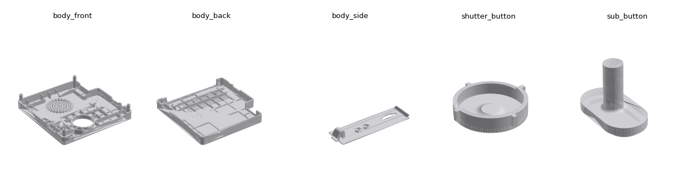
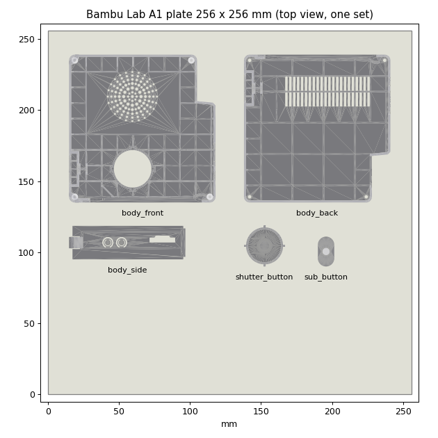

# 本体の筐体 / Main body enclosure

PHOTON GLASS の本体（メインボタン・サブボタン付き）の筐体です。カメラユニット（[`../camera-unit`](../camera-unit)）とは別の筐体です。
FDM方式の3Dプリンター（0.4 mm ノズル）で印刷できます。サポートが要るのはサブボタンのつばの下だけです。

## ファイル
| フォルダ | 形式 | 用途 |
|---|---|---|
| `step/` | STEP | **設計データ**（Fusion で設計したもの）。Fusion・FreeCAD・SolidWorks・Onshape などで開いて編集できる（組み立てた位置のまま） |
| `stl/` | STL | 印刷用。**印刷する向きにそろえてある**ので、そのままスライサーに入れる |
| `3mf/` | 3MF | 印刷用。1台分（5部品）を A1 のプレート1枚に並べたもの |

### 部品
1台分で、それぞれ1個ずつ使います。

| 部品 | ファイル名 | 大きさ（印刷の向き） | 印刷の向き |
|---|---|---|---|
| ボディ前面 | `body_front` | 103 × 104 × 高さ 25.9 mm | 外側の面を下 |
| ボディ背面 | `body_back` | 103 × 104 × 高さ 14.5 mm | 外側の面を下（設計データから裏返してある） |
| ボディ側面 | `body_side` | 81.8 × 23.6 × 高さ 12.3 mm | いちばん大きい面を下に寝かせる |
| メインボタン | `shutter_button` | 直径 29 × 高さ 8 mm | 閉じた底を下 |
| サブボタン | `sub_button` | 11.5 × 21 × 高さ 21.3 mm | 楕円のつばを下、軸を上に立てる |

板の厚さは 1.5 mm、細い壁は 1.0 mm です。

本体の4つのボタン（メイン・サブ・上・下。GPIO はそれぞれ 27・22・23・24）は、プログラムを改変して自由に使えるボタンです。サンプルプログラムで使っているのは `main_async.py` のサブボタン（読み上げなどを途中で止める）だけで、ほかは使っていません。撮影と読み上げは、カメラユニットのボタン（GPIO17）で行います。上ボタンと下ボタンは、ボディ側面と一体になっています。

## 印刷設定
Bambu Lab A1・Bambu Studio での設定です。ほかのプリンターでも、同じ考え方で設定してください。

### 選ぶプリセット
| 項目 | 設定 |
|---|---|
| プリンター | Bambu Lab A1（0.4 mm ノズル） |
| フィラメント | **Bambu PETG HF**（PETG Basic、他社品なら Generic PETG） |
| プロセス | **0.20mm Standard @BBL A1** |
| ビルドプレート | **テクスチャ PEI**。スムース PEI の場合はスティックのりを薄く塗る（PETG がくっつきすぎて PEI がはがれるのを防ぐ） |

温度（ノズル 250 °C 前後、ベッド 70 °C）とファンは、フィラメントのプリセットのままで構いません。

### プリセットから変えるところ
| 項目 | 設定 | 理由 |
|---|---|---|
| 壁のループ数 | **3** | 1.0 mm と 1.5 mm の壁を、中まで詰めて刷るため |
| 壁生成 | **Arachne** | 1.0 mm の細い壁を、すき間なく刷れる |
| 上面 / 底面シェル層 | **5 / 4** | 1.5 mm の板を中まで詰めるため |
| インフィル | 20 %（ジャイロイド） | 薄い部品が多いので、実際にはほとんど中が詰まる |
| 継ぎ目の位置 | **背面**（または「整列」） | 外側の面に継ぎ目の線を出さないため |
| 精密な壁 | オン | はめ合いの精度が上がる |
| エレファントフット補正 | **0.15 mm** | 1層目が広がると、前面と背面・ボタンがはまりにくくなる |
| 外壁の速度 | 120〜150 mm/s | 外側の見た目と寸法の精度が上がる。ほかの速度はプリセットのまま |
| 層の最低時間（この時間より短い層は減速） | **8 秒** | ボタン類や前面の細い柱は1層が小さく、冷えないうちに次の層が乗ると形が崩れる |
| サポート | **オフ**（サブボタンだけ例外、下記） | ほかの4部品は、この向きならサポートがいらない |

### サブボタンだけの追加設定
サブボタンは、床側に高さ 1.7 mm の小さい台座があり、その上でつばが周りに 1.5 mm 張り出しています。この張り出しの下だけサポートを入れます。
1. オブジェクト一覧でサブボタンを右クリックして、設定を追加します。
2. 「サポートを有効」をオン、「ビルドプレートのみ」をオン、上面Z距離 0.2 mm にします（自動で、張り出しの下だけにサポートが入ります）。
3. **ブリム：外側のみ、幅 3 mm**。A1 はベッドが前後に動くので、細い軸が立った部品を倒れにくくします。

### 印刷のしかた
- **1台分ずつ刷ります。** `3mf/main-body_plate_A1.3mf` を開くと、5部品がプレート1枚に並びます（サブボタンの追加設定はこのあとで行います）。
- **1台目を刷ったら、組み合わせを確かめます。** 前面と背面がかみ合うか、ボタンが穴にはまって動くかを見てから、残りを刷ってください。
- **材料**は1台あたり約 65〜75 g です（部品の体積の合計は 61 cm³）。
- **プレートが冷めてから取ります。** 熱いうちに無理にはがすと、前面・背面の薄い板がゆがみます。

### PETG で気を付けること
- **湿気**：糸を引く、表面がぶつぶつする、パチパチ音がする、といったときは、フィラメントを 65 °C で 6〜8 時間乾燥させます。
- **フローダイナミクスのキャリブレーション**をオンにしておきます（メーカーやロットが変わると最適な値がずれるため）。
- 前面の柱のあいだに細い糸が残ったら、ヒートガンで軽くあぶるか、カッターで取ります。

### はまり具合の調整
- ボタンが穴にきつい → そのボタンだけ「X-Y輪郭補正」を −0.05〜−0.1 mm にする。
- ネジ穴やボタンの穴が小さい → その部品だけ「X-Y穴補正」を +0.05〜+0.1 mm にする。

## 必要な部品
| 部品 | 数 |
|---|---|
| 印刷した部品（ボディ前面・背面・側面、メインボタン、サブボタン） | 各1 |
| ネジ ウィルコ FBP-0208EB：ボディ背面とボディ前面を留める | 4 |

## 組み立て
左右と手前・奥は、ボディ前面を外側の面を下にして置き、角が段になったところを右奥にしたときの向きです。この向きで、左の壁にサブボタンの穴、右の壁に HDMI とヘッドホンの穴があり、手前にボディ側面が入ります。

### 中に収めるもの
- メイン基板：Raspberry Pi Zero 2 WH を40ピンソケットに挿し、FFC ケーブルとスピーカーをつないでおきます（つなぎ方は [`docs/BUILD_GUIDE.md` の「つなぐ場所」](../../docs/BUILD_GUIDE.md#つなぐ場所)）。
- スピーカー（MSI28-12R）

### 手順
1. **メインボタン**：閉じた底を外に向けて、ボディ前面の大きな丸い穴に内側からはめる。ふちの4つの出っ張りを、穴のまわりの壁の4つの切り欠きに合わせます。
2. **サブボタン**：小さい台座の側を外に向けて、左の壁の穴に内側から通す。つばは壁の内側に当たり、軸は基板の側を向きます。
3. **スピーカー**：ボディ前面の内側の、スピーカーの穴が並んだところに置く。
4. **メイン基板**：裏（`SW_MAIN` のある面）を前面の側に向けて入れ、次の位置に合わせる。
   - `SW_MAIN`：メインボタンの真上
   - `SW_SUB`：サブボタンの軸の先
   - HDMI（`CN3`）とヘッドホンジャック（`CN1`）：右の壁の2つの穴
   - `VR1`・`SW_UP`・`SW_DOWN`：手前の辺（ボディ側面の側）

   Raspberry Pi は、メイン基板の上（背面の側）に来ます。
5. **ボディ側面**：手前の壁の開いたところにはめる。四角い窓を `VR1` に、切り込みで囲まれた2つの丸いボタン（上ボタン・下ボタン）を `SW_UP`・`SW_DOWN` に合わせます。両端の爪（右は斜めの爪、左は U 字のフック）が、壁の内側に掛かります。
6. **ボディ背面**：かぶせて、背面の四隅にある4つの穴（座ぐり付き）から、ネジ4本で前面に留める。サブボタンとボディ側面は、前面と背面のあいだに挟まれます。

ネジは樹脂に自分でねじ山を切るタイプです。止まったところで締めるのをやめてください。

## 設計を変える
`step/` の STEP を CAD に読み込んで編集します。5部品とも組み立てた位置のままなので、全部を読み込むと組み上がった状態になります。
- 編集したら、部品ごとに STL で書き出し、スライサーで上の「[部品](#部品)」の表の「印刷の向き」に置き直してください（`stl/` のファイルは置き直したものです）。
