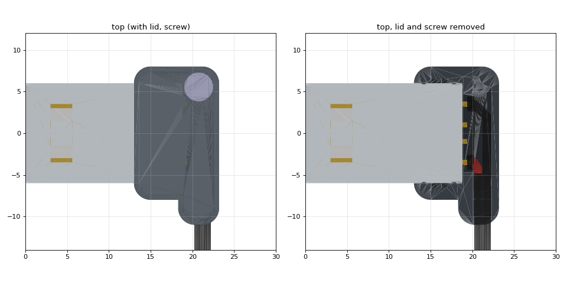

[日本語](README.md) | English

# Power cable (mobile battery → main board)

A cable that carries power from the USB-A output of a mobile battery to the 5V connector (JST XH, 2-pin) on the main board.
It uses a board-mount USB plug, and the soldered part is covered with a 3D-printed cover.

The cover is **L-shaped (cable exits to the right)**. The cable leaves the plug at 90° to the side, so less sticks out from the battery.

| Size (length × width × thickness) | Fixing | Files to print |
|---|---|---|
| 10.2 × 19 × 7.9 mm | One screw (FXB-1430EB) + epoxy adhesive | `stl/usb_cover_L_right_base.stl`, `stl/usb_cover_L_right_lid.stl` |



## Mobile battery to use
cheero Canvas 3200mAh IoT機器対応【USB-C Ver.】 (CHE-061-BK-IOT2; "IoT機器対応" means "for IoT devices")
- Where to buy: cheero's official online store.
- "USB-C Ver." refers to the input port used to charge the battery itself. The power output is USB-A, so it can be used with this cable (USB-A plug).
- Output: USB-A 5V / 2.1A max.
- It is the "for IoT devices" model, which does not cut the power even when the current is small. An ordinary mobile battery may decide that charging is complete and cut the power when the Raspberry Pi is idle and drawing little current.
- Usage: connect the cable and press the battery's power button to start supplying power. Press it again to stop (always stop it when you have finished).

## Parts
| Part | Part number | Where to buy (with the Akizuki product code) | Qty |
|---|---|---|---|
| USB-A plug (board mount, L-shaped) | USB-4AM103AS | Akizuki Denshi 102236 | 1 |
| Wire, red (AWG24, 1.04 mm outer diameter) | 0.2sq (7/0.18) AWG24-R | Akizuki Denshi 111090 | Length of the cable |
| Wire, black (as above) | 0.2sq (7/0.18) AWG24-BK | Akizuki Denshi 111091 | Length of the cable |
| XH housing, 2-pin | JST XHP-2 | Akizuki Denshi 112255 | 1 |
| **XH contacts (crimp terminals)** | **JST SXH-001T-P0.6** | **Akizuki Denshi 112265** | 2 |
| Heat-shrink tubing (1.5–2 mm inner diameter) | | | About 2 cm |
| Heat-shrink tubing (about 2.5 mm inner diameter, to bundle the red and black wires) | | | About 3 cm |
| Screw | WILCO (ウィルコ) FXB-1430EB (M1.4×3.0 low-head B-tite, black) | WILCO | 1 |
| 3D-printed parts | `stl/usb_cover_L_right_base.stl`, `stl/usb_cover_L_right_lid.stl` | | 1 each |
| **Two-part epoxy adhesive** (a 30-minute type is recommended, e.g. Konishi Bond Quick 30) | | | A little |
| Sandpaper (around #240), rubbing alcohol | | | |

- **The XH housing alone cannot hold the wires.** You need metal terminals (contacts) crimped onto the ends of the wires. The one that fits AWG24 wire (1.04 mm insulation outer diameter) is **SXH-001T-P0.6** (for AWG#28–22, insulation outer diameter 0.9–1.9 mm). The similar SXH-001T-P0.6**N** is for insulation of 1.3 mm outer diameter or more, so it does not fit.
- For crimping, use a crimping tool for small terminals (ENGINEER PA-09, HOZAN P-707, etc.).

### Cable length
**1 m or less** is recommended. AWG24 wire has a resistance of about 0.1 Ω per metre, and the voltage drops across both wires, there and back.

| Length | Voltage drop at 1 A | Voltage reaching the board (with the battery at 5.1 V) |
|---|---|---|
| 0.5 m | About 0.1 V | About 5.0 V |
| 1.0 m | About 0.2 V | About 4.9 V |
| 1.5 m | About 0.3 V | About 4.8 V |

Below 4.63 V, the Raspberry Pi goes into "undervoltage" and becomes unstable. For lengths over 1.5 m, use thicker wire, such as AWG22.
Note that the USB plug is rated at 1 A. A Raspberry Pi Zero 2 W + camera + speaker normally stays within this.

## Wiring
```
 USB-A プラグ（USB-4AM103AS）                        XH ハウジング（XHP-2）
 ┌───────────────┐                                  ┌────────┐
 │ 1番 VBUS (+5V)├──────── 赤 AWG24 ─────────────────┤ +5V 側 │──→ メイン基板 5V コネクタ 1番（四角いパッド・「+」印）
 │ 2番 D-        │  （使わない：短く切る）            │        │
 │ 3番 D+        │  （使わない：短く切る）            │        │
 │ 4番 GND       ├──────── 黒 AWG24 ─────────────────┤ GND 側 │──→ メイン基板 5V コネクタ 2番（GND）
 └───────────────┘                                  └────────┘
```
Labels in the diagram: USB-A プラグ = USB-A plug; XH ハウジング = XH housing; 1番–4番 = pins 1–4; 赤 / 黒 = red / black; 使わない：短く切る = not used: cut short; +5V 側 / GND 側 = +5V side / GND side; メイン基板 5V コネクタ 1番（四角いパッド・「+」印）= pin 1 of the 5V connector on the main board (square pad, "+" mark); メイン基板 5V コネクタ 2番（GND）= pin 2 of the 5V connector on the main board (GND).

- Of the four pins of the USB-A plug, **the outer two** carry the power (pin 1 = +5V, pin 4 = GND). The inner two (for data) are not used.
- On the main board's 5V connector, **pin 1 (the square pad, on the side with the "+" mark on the silkscreen) is +5V** and pin 2 is GND. Pin 1 is connected to pin 4 (5V) of the Raspberry Pi's 40-pin header, and pin 2 to pin 6 (GND).

> [!CAUTION]
> **Reversing + and − will destroy the Raspberry Pi** (the Raspberry Pi's 5V input has no reverse-polarity protection). Always carry out "[6. Check](#6-check-before-connecting-to-the-board-required)" in the steps below.

## How to make it
### 1. Print the cover
- Print the base part (`..._base.stl`, bottom down) and the lid (`..._lid.stl`, outer face down) in the orientation they are in. **No support is needed.**
- With the lid (the side where the screw head shows) facing up and the tip of the plug pointing towards you, the cable comes out to the right.
  - If you put the plug into the cover upside down, the cable will point the other way when the plug is in the battery (because a USB plug only goes in one way round). To be sure, before assembling, plug just the plug into the battery, hold the cover against it, and decide which way up the plug should go for the cable to come out on the side you want.

#### Print settings (Bambu Lab A1 / PETG)
The presets, plate and temperatures are the same as for the [main body enclosure](../main-body/README.en.md#print-settings) (Bambu PETG Basic, textured PEI). The cover is small and has fine features (0.25 mm crush ribs, a 1.2 mm pilot hole for the screw), so change the following.

| Item | Setting | Reason |
|---|---|---|
| Process | **0.16mm Optimal @BBL A1** | More layers, so the ribs and ridges on the underside of the lid (1.3 mm thick) print crisply |
| Wall loops | **3** | The outer wall is 1.2 mm. The area around the screw's pilot hole is also solid all the way through |
| Top / bottom shell layers | 5 / 5 | |
| Sparse infill | **100 %** (or close to it) | The parts are small, so the print time hardly changes, and they become stronger against plugging, unplugging and the force of the screw |
| Precise wall | On | Keeps the dimensions of the mating faces and the plug groove accurate |
| Seam position | Back | |
| Minimum layer time | **10 s** | Each layer is very small, and if the next layer goes on before the previous one has cooled, the shape deforms |
| Support / brim | **None** | The outer faces of the base and the lid are flat, so a large area touches the bed |

- **Printing 2–4 sets together** lengthens the time per layer and gives a cleaner finish (and you also get spares).
- If the screw is too tight to go in, or the pilot hole splits, set "X-Y hole compensation" to +0.05 mm for the base part only. If it is too loose instead, set it to −0.05 mm.
- If the plug is tight in its groove, shave the crush ribs down slightly with a craft knife (see step 4).

### 2. Prepare the USB plug
1. **Cut off the two metal legs at the back of the plug, which are for fixing it to a board, right at their base with side cutters** (they are not needed on a cable, and they do not fit in the cover).
2. Of the four pins, **cut the inner two (pins 2 and 3) short at their base** (so that they cannot touch the other pins or the wires).
3. **Straighten the outer two pins (pins 1 and 4) with long-nose pliers so that they point straight back.** **For the L-shaped cover, after straightening them, cut them so that 1.0 mm remains beyond the back face of the plug** (to keep the cover short: the space inside the cover for soldering and bending the wires extends only 3.5 mm behind the plug). The pins of this plug are bent down at a right angle (a board-mount "L type"), so bend them up slowly, once only, so that they stick out horizontally behind the plug. This keeps the soldered joints within the thickness of the plug, so the cover can be thin.
4. **Identify the +5V pin**: plug the plug into the battery, press the power button, and measure between the outer two pins with a multimeter. The pin with +5V on it (the side that reads +5 V when you touch it with the red probe) is pin 1. Mark it with a pen. When you have finished measuring, turn the battery off and unplug the plug.

### 3. Solder the wires
1. Cut the red and black wires to the same length, and strip about 2 mm of insulation from both ends.
2. Slip heat-shrink tubing (about 2 mm) onto the USB-side ends first.
3. Solder the red wire to pin 1 (+5V) and the black wire to pin 4 (GND), laying each wire along its pin (pointing backwards).
4. Slide the heat-shrink tubing over the soldered joints and shrink it with a hair dryer or the heat of the soldering iron.

### 4. Put it in the cover
1. Place the plug in the groove of the base part, **with the face where you cut off the metal legs (the side that would originally sit on a board) facing down**. The straightened pins and the soldered joints go into the rear compartment.
   - In this orientation, looking from above with the end that plugs in pointing away from you, according to the drawing **the left end is pin 1 (+5V, red) and the right end is pin 4 (GND, black)** (go by the mark you made with the multimeter in step 2).
   - The plug also fits in the cover upside down (and there is no electrical problem either).
   - **Push the plug all the way in, so that its back face rests against the two "stoppers" (the walls on either side of the rear compartment).** The side walls and the thin ridges on the underside of the lid (crush ribs) clamp the plug so that it does not rattle. If it is too tight, shave the ribs down slightly with a craft knife.
2. Press the cable (up to 2 mm outer diameter) into the groove. The cable is pinched into a wave shape between two ridges in the bottom of the groove and one ridge on the underside of the lid, so pulling on it puts no force on the soldered joints.
   - The groove is on the side (the side where the cable exits). Bend both wires 90° just behind the soldered joints, and route the wire from the pin on the side opposite the cable exit along the rearmost wall of the compartment (see the right of the image above). The end of the cable (where its outer sheath ends) should come at about the entrance of the groove, inside the compartment. The groove is as deep as the cable, and the flat lid holds the cable down from above. Do not fold the wires sharply; bend them with a slight curve.
   - If you are using separate red and black wires, bundle the part that comes out of the cover into one with heat-shrink tubing (about 2.5 mm inner diameter) before putting it in the groove.
3. **Fix the plug in place with epoxy adhesive** (so that the cover does not come off on its own when you pull the plug out).
   - The stoppers take the force when you push the plug in, but the adhesive takes the force when you pull it out. **Hot-melt glue hardly sticks to metal, so it cannot be used.**
   1. Take the plug out again, **lightly roughen the metal of the part that goes in the cover (about 6 mm from the back) with sandpaper**, and wipe off any grease with alcohol.
   2. Mix the two parts and apply a thin layer to the plug, about 5 mm from the back (on the top, bottom and both sides), and to the cover's groove (the bottom, both sides and the narrow groove on the underside of the lid). **Never get any on the part at the front that plugs in.**
   3. Put the plug back in against the stoppers, and also pour adhesive into the rear compartment (over the soldered joints and the end of the cable).
   4. Close the lid as in the next step, and immediately wipe off any adhesive that squeezes out at the front. Do not plug it into the battery until the adhesive has fully cured (about half a day for a 30-minute type).
   - Once the adhesive in the groove has cured, it acts as a "wedge", so the cover cannot come off the plug.
4. Apply a thin layer of epoxy to the mating faces of the underside of the lid and the base part, and put the lid on from directly above.
5. Fix the rear corner on the side opposite the cable exit with one screw (FXB-1430EB). Stop tightening as soon as the screw stops turning (it cuts its own thread in the pilot hole as it goes in, so overtightening will damage the hole).
   - There is no screw at the front, so hold the front with a clip or masking tape until the adhesive cures. It sets together with the adhesive poured into the compartment, fixing the lid.

### 5. Attach the XH connector
1. Strip about 2 mm of insulation from the other ends of the wires and crimp on the SXH-001T-P0.6 contacts.
2. **Decide the orientation**: plug just the empty housing (XHP-2) into the 5V connector on the main board. Mark with a pen the hole that is on the side of the "+" mark (square pad) on the board, then unplug it.
3. Push the red wire's contact into the marked hole and the black one into the other hole, until each clicks.
4. Twisting the two wires together lightly makes the cable easier to handle.

### 6. Check before connecting to the board (required)
1. Plug the cable into the battery and press the power button.
2. Measure between the two contacts of the XH housing with a multimeter. It is OK if **the red side is +5 V** (about 4.9–5.2 V). If you get a negative reading, red and black are the wrong way round.
3. Turn the battery off, then plug the cable into the 5V connector on the main board.

## Files
| Folder | Contents |
|---|---|
| `src/usb_plug_cover.py` | Design data for the cover (CadQuery). Change the dimensions and regenerate it |
| `step/` | For CAD (parts in their assembled positions) |
| `stl/` | For printing (already oriented for printing) |
| `assembly/usb_plug_with_cover_L_right.step` | **A 3D model of the USB plug, wires, cable and screw put together with the cover** (coloured, and separated into parts). For checking the appearance and dimensions. To regenerate it, use `src/usb_plug_assembly.py` |
| `assembly/usb_plug_with_cover_L_right.stl` | Everything above merged into one (for looking at in a viewer; not for printing) |

Cover dimensions: 10.2 long × 19 wide × 7.9 mm thick (3 mm wider on the side where the cable exits). 13 mm of the plug, from its tip, sticks out of the cover. When it is plugged into the battery, it sticks out about 12 mm from the socket.
- The screw is in the rear corner on the side opposite the cable exit. This is the only place where a screw boss fits without changing the outer shape, so there is just one screw (on either side at the front, there is only 1.9 mm between the plug and the outer wall).
- The position of the front of the cover is based on a measurement: **when the plug is pushed fully into the battery, 7.5 mm of it sticks out of the socket** (leaving a 1.7 mm gap between the socket and the cover). If the cover hits a different battery, change `PROTRUDE` (the length that sticks out) in `src/usb_plug_cover.py` to your measured value and regenerate it.
- The thickness of the cable can be changed with `CABLE_D` (2.0 mm by default).
The dimensions of the plug are taken from the manufacturer's drawing (USB-4AM103). If they do not match your plug, change the values at the top of `src/usb_plug_cover.py` (`PLUG_W`, `PLUG_T`, `CLR`, etc.) and regenerate it.

```bash
pip install cadquery
python src/usb_plug_cover.py out/           # カバー（底・ふた）
python src/usb_plug_assembly.py assembly/   # 組み合わせモデル（step/ のカバーを使う）
```
(The comments mean: the cover (base and lid); the combined model (uses the cover in `step/`).)
The `*_print.stl` files created in `out/` are the ones oriented for printing (the contents of `stl/`).
