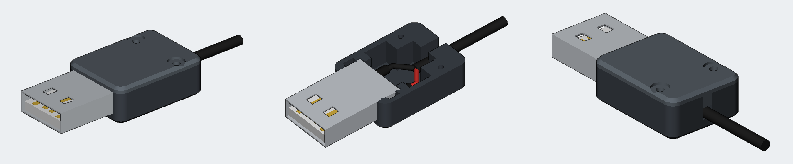
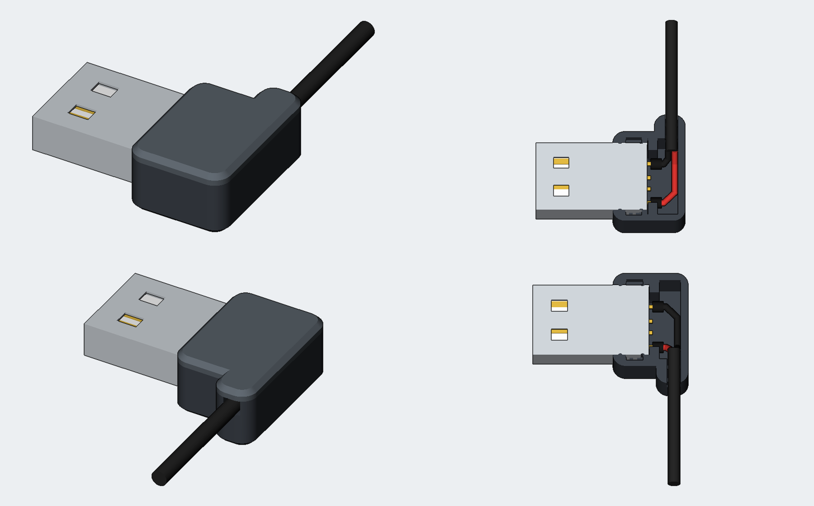
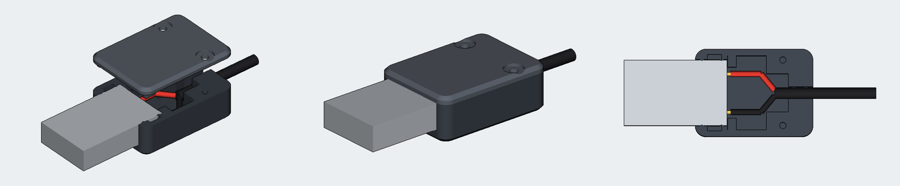

# 電源ケーブル（モバイルバッテリー → メイン基板）

モバイルバッテリーの USB-A 出力から、メイン基板の 5V コネクタ（JST XH 2ピン）へ電源を送るケーブルです。
USB プラグは基板用の部品を使い、はんだ付けした部分を 3D プリントのカバーで覆います。

カバーは2種類から選べます。

| 種類 | ケーブルの出る向き | 大きさ（長さ × 幅 × 厚さ） | 印刷するファイル |
|---|---|---|---|
| **ストレート** | 後ろへまっすぐ | 21.5 × 16 × 7.9 mm | `stl/usb_cover_base.stl`、`stl/usb_cover_lid.stl` |
| **L型** | 横へ90° | **12.2** × 19 × 7.9 mm（ネジなし・接着で固定） | `stl/usb_cover_L_left_*.stl` または `stl/usb_cover_L_right_*.stl` |



*USB プラグとカバーを組み合わせたところ（ストレート）*



*L型（上：左出し、下：右出し。右はふたを外して中を見たところ）*



*USB プラグのカバー（左：組み立て途中、中：完成、右：ふたを外して上から見たところ）*

## 使うモバイルバッテリー
cheero Canvas 3200mAh IoT機器対応【USB-C Ver.】（CHE-061-BK-IOT2）
- 出力：USB-A 5V / 2.1A max.
- 「USB-C Ver.」は、バッテリー本体を充電する入力側の端子のことです。給電の出力は USB-A なので、このケーブル（USB-A プラグ）で使えます。
- 小さい電流でも給電を止めない「IoT機器対応」品。普通のモバイルバッテリーは、Raspberry Pi が待機中で電流が少ないと「充電完了」と判断して給電を止めてしまうことがあります。
- 使い方：ケーブルをつないで、バッテリーの電源ボタンを押すと給電が始まります。止めるときはもう一度押します（使い終わったら必ず止める）。

## 部品
| 部品 | 型番 | 秋月の通販コード | 数 |
|---|---|---|---|
| USB-A プラグ（基板用・L型） | USB-4AM103AS | 102236 | 1 |
| 電線 赤（AWG24、外径 1.04 mm） | 0.2sq (7/0.18) AWG24-R | 111090 | ケーブルの長さ分 |
| 電線 黒（同上） | 0.2sq (7/0.18) AWG24-BK | 111091 | ケーブルの長さ分 |
| XH ハウジング 2ピン | XHP-2 | 112255 | 1 |
| **XH コンタクト（圧着端子）** | **SXH-001T-P0.6** | **112264**（10個入） | 2 |
| 熱収縮チューブ（内径 1.5〜2 mm） | | | 2 cm 程度 |
| 熱収縮チューブ（内径 2.5 mm 程度、赤黒をまとめる場合） | | | 3 cm 程度 |
| ネジ（ストレートのみ） | ウィルコ FXB-1430EB（M1.4 × 3.0 低頭Bタイト） | | 2 |
| 3D プリント部品 | ストレート：`stl/usb_cover_base.stl`、`stl/usb_cover_lid.stl`<br>L型：`stl/usb_cover_L_left_base.stl`、`stl/usb_cover_L_left_lid.stl`（右出しは `L_right`） | | 各1 |
| **2液性エポキシ接着剤**（30分硬化タイプがおすすめ。例：コニシ ボンド クイック30） | | | 少し |
| 紙やすり（#240 前後）、消毒用アルコール | | | |

- **XH ハウジングだけでは電線をつなげません。** 電線の先に圧着する金属の端子（コンタクト）が必要です。AWG24 の電線（被覆の外径 1.04 mm）に合うのは **SXH-001T-P0.6** です（適合 AWG#28〜22、被覆外径 0.9〜1.9 mm）。似た型番の SXH-001T-P0.6**N** は被覆外径 1.3 mm 以上用なので合いません。
- 圧着には、細い端子用の圧着工具（エンジニア PA-09、ホーザン P-707 など）を使います。

### ケーブルの長さ
**1 m 以下**をおすすめします。AWG24 の電線は 1 m あたり約 0.1 Ω で、行きと帰りの2本分の電圧が下がります。

| 長さ | 1 A 流れたときの電圧の低下 | 基板に届く電圧（バッテリー 5.1 V のとき） |
|---|---|---|
| 0.5 m | 約 0.1 V | 約 5.0 V |
| 1.0 m | 約 0.2 V | 約 4.9 V |
| 1.5 m | 約 0.3 V | 約 4.8 V |

Raspberry Pi は 4.63 V を下回ると「電圧不足」になり、動作が不安定になります。1.5 m を超える場合は、AWG22 などの太い電線にしてください。
なお、USB プラグの定格は 1 A です。Raspberry Pi Zero 2 W ＋ カメラ ＋ スピーカーなら、通常はこの範囲に収まります。

## 配線
```
 USB-A プラグ（USB-4AM103AS）                        XH ハウジング（XHP-2）
 ┌───────────────┐                                  ┌────────┐
 │ 1番 VBUS (+5V)├──────── 赤 AWG24 ─────────────────┤ +5V 側 │──→ メイン基板 5V コネクタ 1番（四角いパッド・「+」印）
 │ 2番 D-        │  （使わない：短く切る）            │        │
 │ 3番 D+        │  （使わない：短く切る）            │        │
 │ 4番 GND       ├──────── 黒 AWG24 ─────────────────┤ GND 側 │──→ メイン基板 5V コネクタ 2番（GND）
 └───────────────┘                                  └────────┘
```
- USB-A の4本のピンのうち、**外側の2本**が電源です（1番 = +5V、4番 = GND）。内側の2本（データ用）は使いません。
- メイン基板の 5V コネクタは、**1番（四角いパッド、シルクの「+」印の側）が +5V**、2番が GND です。1番は Raspberry Pi の 40ピンの 4番（5V）に、2番は 6番（GND）につながっています。

> [!CAUTION]
> **+ と − を逆にすると、Raspberry Pi が壊れます**（Raspberry Pi の 5V 入力には逆接続の保護がありません）。下の手順の「[6. 確認](#6-確認基板につなぐ前に必ず)」を必ず行ってください。

## 作り方
### 1. カバーを印刷する
- 底の部品（`..._base.stl`、底を下）とふた（`..._lid.stl`、外側の面を下）を、そのままの向きで印刷します。**サポートは不要**です。
- **L型の左出し・右出しの決め方**：ふたを上にして、プラグの先を向こうに向けたとき、ケーブルが左に出るのが `L_left`、右に出るのが `L_right` です。
  - **どちらか1つを印刷すれば、両方の向きに対応できます。** プラグをカバーに上下逆に入れると、バッテリーに挿したときのケーブルの向きが反対になります（USB は片方の向きにしか挿さらないため）。
  - 組み立てる前に、プラグだけをバッテリーに挿し、カバーを当ててみて、ケーブルを出したい側になるプラグの向きを決めておくと確実です。
- 設定は筐体と同じでかまいません（PETG または PLA、0.16 mm、壁3周、インフィル 20 %）。[カメラユニットの印刷設定](../camera-unit/README.md#印刷設定)を見てください。

### 2. USB プラグを準備する
1. プラグの後ろ側にある、**基板に固定するための金属の足（2本）をニッパーで根元から切り落とす**（ケーブルでは不要で、カバーに入らないため）。
2. 4本のピンのうち、**内側の2本（2番・3番）を根元で短く切る**（ほかのピンや電線に触れないように）。
3. **外側の2本（1番・4番）を、ラジオペンチで後ろへまっすぐに伸ばす**。**L型のときは、伸ばしたあと、プラグの後ろの面から 1.5 mm を残して切る**（カバーを短くするため）。このプラグはピンが直角に下へ曲がっている（基板用の「L型」）ので、1回だけゆっくり起こして、プラグの後ろへ水平に出るようにします。こうすると、はんだ付けした部分がプラグの厚みの中に収まり、カバーを薄くできます。
4. **+5V のピンを確かめる**：プラグをバッテリーに挿して電源ボタンを押し、テスターで外側の2本の間を測ります。+5V が出ている側（赤いテスター棒を当てて +5 V と表示される側）が 1番です。目印にペンで印を付けておきます。測り終えたらバッテリーを止めて抜きます。

### 3. 電線をはんだ付けする
1. 赤と黒の電線を同じ長さに切り、両端の被覆を 2 mm ほどむく。
2. USB 側の端に、熱収縮チューブ（ストレートは 5 mm 程度、L型は 2.5 mm 程度）を先に通しておく。
3. 赤を 1番（+5V）、黒を 4番（GND）のピンに、ピンと電線を沿わせるように（後ろ向きに）はんだ付けする。
4. 熱収縮チューブをはんだ付けした部分にかぶせて、ドライヤーやはんだごての熱で縮める。

### 4. カバーに入れる
1. プラグを、**金属の足を切り落とした面（もともと基板に付く側）を下にして**、底の部品（base）の溝に置く。伸ばしたピンとはんだ付け部分は、後ろの部屋に入る。
   - この向きで、差し込む側を向こうにして上から見ると、図面上は**左端が 1番（+5V・赤）、右端が 4番（GND・黒）**になります（手順2でテスターで確かめた印を優先してください）。
   - プラグを上下逆に入れてもカバーには収まります（電気的にも問題なし）。
   - **プラグを奥まで押し込み、後ろの面を左右2つの「ストッパー」（後ろの部屋の両脇の壁）に当てる。** 横の壁と、ふたの裏の細い出っ張り（つぶしリブ）がプラグを挟んで、がたつかないように押さえます。きつい場合は、リブをカッターで少し削ってください。
2. ケーブル（外径 2 mm まで）を溝に押し込む。溝の底の2本の山と、ふたの裏の1本の山でケーブルが波形に挟まれ、引っ張ってもはんだ付け部分に力がかからなくなります。
   - **ストレート**：溝は後ろにあります。
   - **L型**：溝は横（ケーブルを出す側）にあります。2本の電線をはんだ付け部分のすぐ後ろで90°曲げ、ケーブル出口と反対側のピンの電線は、部屋のいちばん後ろの壁に沿わせて回します（上の画像の右側を参照）。ケーブルの端（被覆の切れ目）は、部屋の中の溝の入り口あたりに来るようにします。溝はケーブルと同じ深さで、平らなふたで上から押さえます。電線は急に折らず、少し丸みを付けて曲げてください。
   - 赤と黒の電線をばらで使う場合は、カバーから出る部分を熱収縮チューブ（内径 2.5 mm 程度）でまとめて1本にしてから溝に入れてください。
3. **プラグをエポキシ接着剤で固定する**（抜くときにカバーだけが外れないようにするため）。
   - ストッパーは「押し込む方向」を受け止めますが、「抜く方向」は接着剤で受け止めます。**ホットボンドは金属にほとんどくっつかないので使えません**。
   1. いったんプラグを取り出し、**カバーに入る部分（後ろから約 6 mm）の金属を紙やすりで軽く荒らし**、アルコールで脂を拭き取る。
   2. 2液を混ぜ、プラグの後ろから約 5 mm の範囲（上下左右の面）と、カバーの溝（底・両側・ふたの裏の細い溝）に薄く塗る。**先の差し込む部分には絶対に付けない**。
   3. プラグを入れ直してストッパーに当て、後ろの部屋（はんだ付け部分とケーブルの端）にも接着剤を流し込む。
   4. 次の手順でふたを閉め、前からはみ出した接着剤はすぐに拭き取る。完全に固まるまで（30分タイプで半日ほど）バッテリーに挿さない。
   - 溝に入った接着剤が固まると「くさび」になり、カバーがプラグから抜けなくなります。
4. ふた（lid）を、**最終位置より 1.4 mm ほど後ろにずらして**かぶせ、前へスライドさせる。前側の2つのツメが、底の部品の溝の下に入って止まる。
5. **ストレート**：後ろの2か所をネジ（FXB-1430EB）で留める。ネジは止まったところで締めるのをやめる。
   **L型**：ネジはありません。ふたの裏と底の部品の合わせ面にもエポキシを薄く塗っておき、ふたをかぶせたら、固まるまでマスキングテープやクリップで押さえておく。部屋に流し込んだ接着剤と一緒に固まり、ふたが固定されます。

### 5. XH コネクタを付ける
1. 電線のもう一方の端の被覆を 2 mm ほどむき、SXH-001T-P0.6 を圧着する。
2. **向きを決める**：空のハウジング（XHP-2）だけを、メイン基板の 5V コネクタに挿してみる。基板の「+」印（四角いパッド）側に来る穴に、ペンで印を付けて抜く。
3. 赤の端子を印を付けた穴に、黒をもう一方の穴に、カチッと音がするまで差し込む。
4. 2本の電線を軽くねじり合わせておくと、扱いやすくなります。

### 6. 確認（基板につなぐ前に必ず）
1. ケーブルをバッテリーに挿し、電源ボタンを押す。
2. テスターで XH ハウジングの2本の端子の間を測る。**赤の側が +5 V**（4.9〜5.2 V 程度）なら OK。マイナスの値が出たら、赤と黒が逆です。
3. バッテリーを止めてから、メイン基板の 5V コネクタに挿す。

## ファイル
| フォルダ | 内容 |
|---|---|
| `src/usb_plug_cover.py` | カバーの設計データ（CadQuery）。寸法を変えて作り直せる。ストレート／L型（左・右）を選べる |
| `step/` | CAD 用（組み立てた位置のまま） |
| `stl/` | 印刷用（印刷する向きにそろえてある） |
| `assembly/usb_plug_with_cover.step` | **USB プラグ・電線・ケーブルとカバーを組み合わせた3Dモデル**（色付き、部品ごとに分かれている）。見た目や寸法の確認用。作り直すときは `src/usb_plug_assembly.py` |
| `assembly/usb_plug_with_cover.stl` | 上の全部を1つにまとめたもの（ビューアで見る用。印刷用ではない） |
| `assembly/usb_plug_with_cover_L_left.*`、`..._L_right.*` | L型（左出し・右出し）の組み合わせモデル |

カバーの寸法：ストレートは長さ 21.5 × 幅 16 × 厚さ 7.9 mm、L型は長さ 12.2 × 幅 19 × 厚さ 7.9 mm（ケーブルを出す側が 3 mm 広い）。どちらもプラグの先から 13 mm がカバーの外に出ます。L型をバッテリーに挿したときの出っ張りは、差し込み口から約 14 mm です。
- カバーの前の位置は、**バッテリーに奥まで挿したとき、プラグが差し込み口から 7.5 mm 出る**という実測値から決めています（差し込み口とカバーの間に 1.7 mm のすき間）。別のバッテリーで当たる場合は、`src/usb_plug_cover.py` の `PROTRUDE`（出ている長さ）を測った値に変えて作り直してください。
- ケーブルの太さは `CABLE_D`（初期値 2.0 mm）で変えられます。

プラグの寸法は、メーカーの図面（USB-4AM103）から作っています。実物と合わないときは、`src/usb_plug_cover.py` の先頭の数値（`PLUG_W`、`PLUG_T`、`CLR` など）を変えて作り直してください。

```bash
pip install cadquery
python src/usb_plug_cover.py out/ all          # all = ストレート・L型（左）・L型（右）を全部作る
python src/usb_plug_assembly.py assembly/ all  # 組み合わせモデル（step/ のカバーを使う）
```
`all` の代わりに `straight`、`left`、`right` で1種類だけ作れます。`out/` にできた `*_print.stl` が印刷の向きにそろえたもので、名前から `_print` を除いたものが `stl/` のファイルです（`_print` の付かない STL は、組み立てた位置のまま）。
